<p align="center">
  
</p>

<h1 align="center">Jarvis AI Desktop</h1>

<p align="center">
  <b>A 2.5 MB Windows tray app for a self-hosted AI voice assistant, built with Tauri 2 and Rust.</b><br>
  Wake word from start-up, global hotkeys, a floating mini orb, Windows toasts and start with Windows,<br>
  wrapped around any web page you host yourself. No Electron, no bundled Chromium.
</p>

<p align="center">
  
  
  
  
  <a href="LICENSE"></a>
</p>

<p align="center">
  <a href="https://jackwent.co.uk/jarvis-ai-windows-app-tauri/"><b>Read the build write-up</b></a> ·
  <a href="https://github.com/JackWent/Jarvis">Jarvis, the homelab assistant behind it</a> ·
  <a href="#use-it-for-your-own-web-app">Use it for your own app</a>
</p>

<p align="center">
  
</p>

My family talks to Jarvis, the AI assistant that runs my homelab, through a web page. A bookmark isn't an app, though, so this wraps that page in a proper Windows program. It lives in the tray, starts with Windows and listens for "Hey Jarvis" without anyone opening a browser.

This repo is the **desktop shell only**. The assistant and the page it loads are private, so out of the box it points at `jarvis.example.com`. Point it at your own page and you have a small native-feeling app for any self-hosted assistant or dashboard, for example Open WebUI or Home Assistant.

## Features

- **Tiny installer.** About 2.5 MB, because Tauri uses the WebView2 runtime that Windows already has rather than shipping a copy of Chromium the way Electron does.
- **System tray app.** The close button hides to the tray and listening carries on. Quit is in the tray menu.
- **Global hotkeys.** `Ctrl+Alt+J` shows or hides the window and `Ctrl+Alt+M` switches to the mini orb. If another program already owns a hotkey, the app still starts.
- **Mini orb mode.** The same window, shrunk to 260 × 260, frameless and always on top. It's still one page, one socket and one microphone.
- **Wake word from start-up.** The microphone is allowed for your page without a prompt, and audio can play without a first click, so "Hey Jarvis" works straight after boot.
- **Pause listening** from the tray, with a tooltip that shows when it's not listening.
- **Starts with Windows**, hidden in the tray. It's on by default after the first run, and you can untick it in the tray menu.
- **Windows toast notifications**, which the page can raise when an alert arrives while the window is hidden.
- **Feels like an app, not a browser.** No right-click menu, text selection, zoom, reload, view-source or DevTools shortcuts. Dropped files go to the page.
- **Offline screen.** A bundled "can't reach Jarvis" page checks the server and has a retry button.
- **Single instance**, and the window size and position are remembered.
- **Works away from home** behind Cloudflare Access and a Cloudflare Tunnel, with no ports open on the home firewall.

## Security model

The window loads a remote page, so the app is strict about what that page can reach:

- **Navigation allowlist.** The window can only load your page's host, `*.cloudflareaccess.com` for sign-in, and its own bundled pages. Everything else is blocked ([`main.rs`](desktop/src-tauri/src/main.rs)).
- **Two commands, one hostname.** The remote page can call `toast` and `mini` and nothing else, and only from your hostname ([`capabilities/remote.json`](desktop/src-tauri/capabilities/remote.json)). No file, shell or network access is exposed to it. The bundled offline page gets no commands at all.
- **Only the microphone is auto-approved.** A WebView2 permission handler allows just the microphone. Camera, location and screen capture keep WebView2's normal behaviour, so the screen-share picker still appears.
- **Toast text is capped** at 80 characters for the title and 300 for the body.

## Use it for your own web app

1. **Change the URL.** Replace `jarvis.example.com` in three files:
   - `desktop/dist/index.html`: the offline page. It checks `api/session` on your server before loading the page, so point that at any URL your server answers.
   - `desktop/src-tauri/src/main.rs`: the navigation allowlist. Drop the `cloudflareaccess.com` line if you don't use Cloudflare Access.
   - `desktop/src-tauri/capabilities/remote.json`: the hostname allowed to call the app's commands.
2. **Rename it.** Set `productName` and `identifier` in [`tauri.conf.json`](desktop/src-tauri/tauri.conf.json), and the window title and tray text in `main.rs`.
3. **Replace the icons** in `desktop/src-tauri/icons/` and `desktop/dist/icon.png`. They're my own artwork, so please don't ship them.
4. **Optionally, hook your page into the app:**

   ```js
   if (window.__JARVIS_APP) {                       // set by the app in every page it loads
     const { invoke } = window.__TAURI__.core;
     invoke("toast", { title: "Front door", body: "Someone is at the door" });
     invoke("mini", { on: true });                  // switch to the mini orb
   }
   // The tray's "Pause listening" calls this on your page, if it exists:
   window.__orbPause = (paused) => { /* stop or start your wake word */ };
   ```

## Building

**On Windows**, with [Rust](https://rustup.rs/) and the [Tauri prerequisites](https://tauri.app/start/prerequisites/) installed:

```bash
cargo install tauri-cli --version "^2" --locked
cd desktop/src-tauri
cargo tauri build
```

**From Linux** (which is how I build it, in GitLab CI), cross-compiling with `cargo-xwin` and NSIS:

```bash
sudo apt install nsis lld llvm
rustup target add x86_64-pc-windows-msvc
cargo install cargo-xwin --locked
cd desktop/src-tauri
cargo tauri build --runner cargo-xwin --target x86_64-pc-windows-msvc
```

Either way you get an NSIS `Setup.exe` that installs per user, so it needs no admin rights. It's unsigned, so Windows SmartScreen will say "unknown publisher". Choose **More info**, then **Run anyway**.

## Project layout

```
desktop/
├── dist/index.html              bundled "connecting / can't reach" page
└── src-tauri/
    ├── src/main.rs              tray, hotkeys, mini orb, autostart, allowlist, mic permission, toasts
    ├── capabilities/remote.json what the remote page may call (toast, mini)
    ├── capabilities/local.json  the bundled page may call nothing
    ├── tauri.conf.json          window and NSIS installer settings
    └── Cargo.toml               Tauri 2 plus the single-instance, autostart, global-shortcut,
                                 notification and window-state plugins
```

## The write-up

[Build a Windows App for Your Self-Hosted AI Assistant with Tauri (Rust)](https://jackwent.co.uk/jarvis-ai-windows-app-tauri/) covers why I chose Tauri over Electron, reaching it from anywhere with no open ports, giving the family a restricted Jarvis, what went wrong, and building the installer without a Windows machine.

## Licence

[MIT](LICENSE). The icons are my own artwork, so please replace them with your own before publishing a build.
